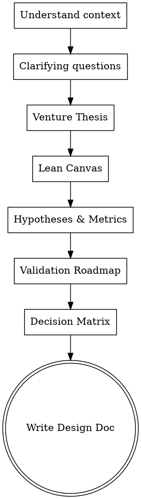

# Business Design Workshop

Interactive workshop that turns a venture idea into a structured, testable business design. Output: a design document with venture thesis, Lean Canvas, validation hypotheses, validation roadmap, and decision matrix.

Communicate in the user's language. If the project or user is German-language, use German in conversation and in the generated business design document. Be analytical, direct, and pragmatic.

## Project Context

$ARGUMENTS

## Agent Portability

This skill must work across Codex, Claude, and other SKILL.md-compatible agents.

- Do not assume a specific slash-command system.
- Do not rely on any agent-specific question tool. If a structured question tool is available, use it; otherwise ask one concise plain-text question.
- Check common project instruction files when present: `AGENTS.md`, `CLAUDE.md`, `README.md`, `.cursor/rules`, `.windsurfrules`, and equivalent project docs.
- Do not assume a specific file structure; adapt output paths to the repository. Prefer `docs/plans/` only when it exists or matches project conventions.

## Workflow: 5 Sections

Guide the user through one section at a time. Present each section, wait for approval, then continue. Ask one question per message, with multiple choice when useful.



---

### Step 0: Understand Context

Before asking questions, read existing docs if present:

- `docs/plans/` or equivalent planning docs: existing design docs and due-diligence outputs
- Project instruction files: `AGENTS.md`, `CLAUDE.md`, `README.md`, `.cursor/rules`, `.windsurfrules`
- Recent git commits: current project state

Then ask clarifying questions, one per message:

1. **Vision**: Is this a one-off test or a long-term business?
2. **Revenue model**: How should it make money, or is this still unclear?
3. **Target output**: What should exist at the end?
4. **Document audience**: Who is this document for: internal team, investors, sponsors, or another audience?

Adapt depth and tone to the answers. If revenue is unclear, do not force revenue assumptions. If the audience is investors, use a more evidence-oriented and persuasive tone with market data where available.

---

### Section 1: Venture Thesis

Based on the answers, draft:

- **One-liner:** One sentence describing the entire venture.
- **Core thesis:** 2-3 sentences describing the market problem, solution, and connection between target groups.
- **Unfair advantage:** 2-4 bullet points explaining what this venture has that others cannot easily copy.

Present the section and wait for approval before continuing.

---

### Section 2: Lean Canvas

Create a Lean Canvas table with these fields:

| Field | Description |
|---|---|
| **Problem** | What is the core problem? Why does it exist? |
| **Target groups** | Primary and secondary groups, if present, such as users and B2B partners. |
| **Value proposition** | Concrete value for each target group. |
| **Solution** | How the problem is solved. Be concrete, not abstract. |
| **Channels** | How the target groups will be reached. |
| **Revenue streams** | How money is made. Use "TBD after validation" when honestly unclear. |
| **Cost structure** | Main cost drivers. |
| **Key metrics** | Numbers that show whether it works. |
| **Unfair advantage** | Why competitors cannot simply copy it. |

Use Lean Canvas instead of the classic Business Model Canvas because it fits early-stage validation better. Fields may be `TBD` when assumptions are genuinely unknown.

Present the section and wait for approval.

---

### Section 3: Hypotheses & Experiment Metrics

Create 2-5 testable hypotheses as a table:

| # | Hypothesis | Pass criterion | Fail criterion | Measurement method |
|---|---|---|---|---|
| H1 | Clear, falsifiable statement | Concrete threshold | Concrete threshold | Exact measurement method |

Rules for good hypotheses:

- Each hypothesis must be falsifiable with clear pass/fail thresholds.
- Measurement methods must be concrete, such as a database query, survey question, or analytics event.
- Separate pre-launch hypotheses, testable through landing pages or ads, from post-launch hypotheses, testable only after product or event usage.
- Sort by test order: what can be tested first?

Present the section and wait for approval.

---

### Section 4: Validation Roadmap

Create a 3-phase roadmap.

#### Phase 1: Signal

- **Goal:** Prove demand with minimal investment.
- Concrete action plan as a table: step, action, timeline.
- Estimated cost for Phase 1.
- Which hypotheses are tested in Phase 1?
- **Stealth vs. open launch:** Recommend stealth or cold traffic when the idea is unvalidated, because a personal network can create bias.

#### Phase 2: Repeat

- **Goal:** Prove repeatability.
- 4-5 bullet points describing what happens if Phase 1 succeeds.

#### Phase 3: Scale

- **Goal:** Define a scalable model.
- 4-5 bullet points covering expansion, revenue validation, and partnerships.

Present the section and wait for approval. Adapt if the user rejects a stealth approach.

---

### Section 5: Decision Matrix

Create a decision matrix covering all realistic scenarios:

| Scenario | Hypothesis A | Hypothesis B | Decision |
|---|---|---|---|
| **Best case** | Pass | Pass | **Go.** Continue to the next phase. |
| **Partial success A** | Pass | Fail | **Go with reservation.** State what must change. |
| **Partial success B** | Fail | Pass | **Pivot.** State the exact pivot. |
| **Wrong audience** | Pass with wrong audience | Any | **Pivot audience.** |
| **Worst case** | Fail | Fail | **Kill or fundamental pivot.** Run a post-mortem. |

Add mandatory kill criteria so the team does not waste money:

- Concrete threshold plus timeframe that triggers a stop.
- Early warning signal that triggers immediate messaging changes.

Present the section and wait for approval.

---

## After The Workshop

### Save The Design Doc

Summarize all 5 sections in a document and save it using the repository's planning-document convention. If no convention exists, use:

```text
docs/plans/YYYY-MM-DD-<project-name>-business-design.md
```

Format:

```markdown
# Business Design: [Project Name]

**Date:** YYYY-MM-DD
**Status:** Approved
**Venture:** [Venture Name]
**Audience:** [Document audience]

---

## 1. Venture Thesis
[...]

## 2. Lean Canvas
[...]

## 3. Hypotheses & Experiment Metrics
[...]

## 4. Validation Roadmap
[...]

## 5. Decision Matrix
[...]

---

## Validation Tool
[Reference to landing page, MVP, or experiment implementing Phase 1]
```

### Commit

Only commit if the user asked for commits or the repository workflow clearly expects it:

```bash
git add docs/plans/YYYY-MM-DD-*-business-design.md
git commit -m "Add [ProjectName] business design document"
```

### Next Step

Ask the user what to do next:

```text
The business design is ready. How do you want to continue?
```

Options:

- **Build validation tool:** design or implement the landing page, MVP, or experiment.
- **Deepen due diligence:** research market, competitors, assumptions, and risks.
- **Legal compliance check:** if the skill `legal-audit` is available, load it and audit the project according to its rules. Otherwise, note that legal compliance (Impressum, Datenschutz, AGB, cookie consent) should be reviewed separately before launch.
- **Stop for now:** no further action.

---

## Rules

1. One section at a time; never jump ahead.
2. Require approval for each section before continuing.
3. Ask one question per message; prefer multiple choice when useful.
4. Be honest: `TBD` is better than invented assumptions.
5. Hypotheses must be falsifiable; avoid soft wish statements.
6. Kill criteria are mandatory.
7. Use Lean Canvas instead of classic BMC for pre-validation ventures.
8. Recommend cold-signal validation when the idea is unvalidated, because personal-network feedback is biased.
9. Read existing docs before drafting final outputs.
10. Conversation and document language should follow the user/project language; code, filenames, and commits should remain English unless the repository convention differs.
